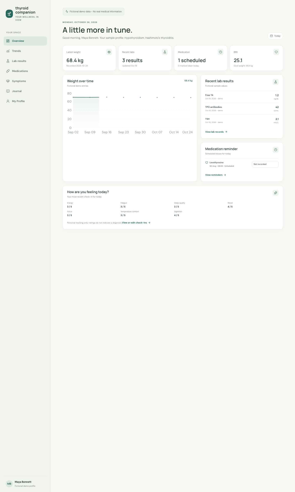
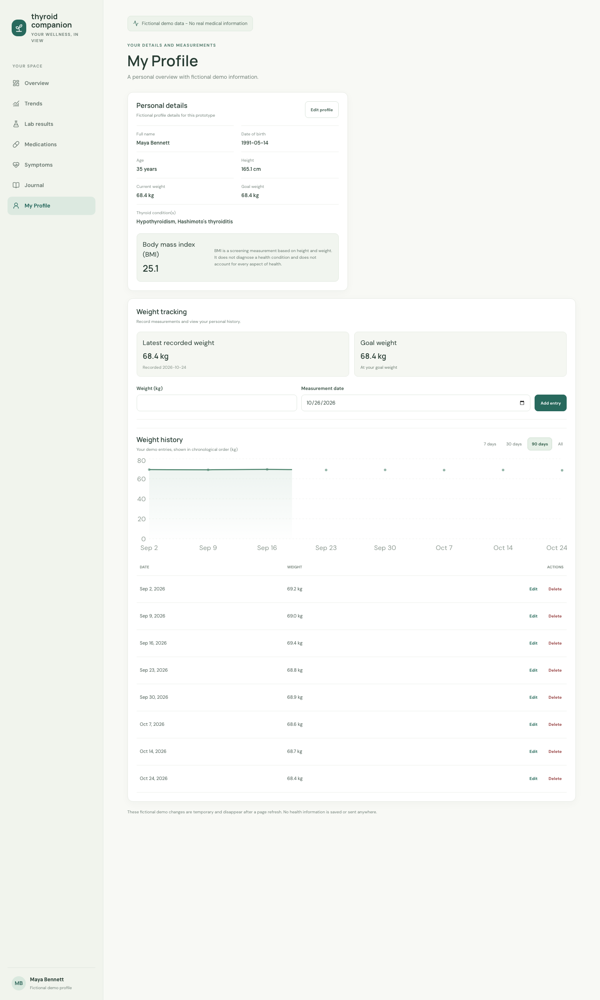
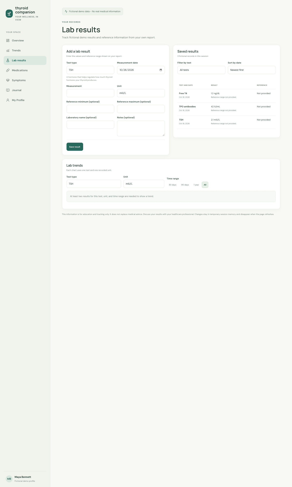
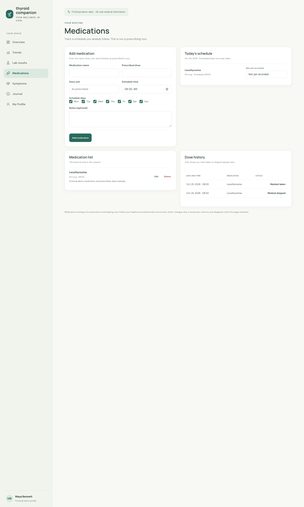
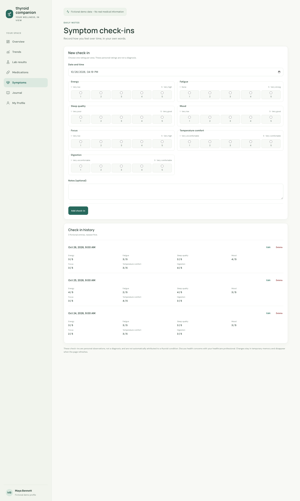

# Thyroid Companion

**A React and TypeScript app for organizing fictional thyroid-health tracking in one place.**

This portfolio prototype combines profile and weight records, lab results, medication schedules, and symptom check-ins in a responsive interface. It focuses on typed data models, shared client state, and clear tracking workflows—not diagnosis or treatment.

## Engineering Highlights

- Strict TypeScript domain models and typed React Context for shared health records.
- Reusable validation and sorting helpers separated from page components.
- Accessible forms, keyboard-operable controls, and responsive layouts.
- 96 automated tests across calculations, validation, feature flows, trends, reports, PDF generation, and dashboard synchronization.
- Feature routes and chart modules load on demand, reducing the initial JavaScript entry by about 47% gzip compared with the pre-Phase 8 build.
- Lab comparisons use only user-entered reference limits; medication status is never inferred from elapsed time.



## What It Solves

Personal measurements and notes can be scattered across paper reports and separate tools. This prototype explores a single place to record and review those items, while keeping the data model explicit and the interface focused on tracking rather than diagnosis or treatment advice.

All sample people and health values are fictional. Changes are held in React memory and disappear when the page is refreshed.

## Completed Features

- **Overview:** summary cards, weight chart, recent lab values, today's scheduled medication status and symptom check-in, plus daily food, hydration, and activity summaries.
- **Profile and weight tracking:** editable profile, BMI calculation, weight entry history, sorting, and weight trends.
- **Lab results:** add, edit, and delete results; filter by test; sort by date; record user-supplied reference limits; and chart results by test and unit.
- **Medication tracking:** record a medication and its prescribed schedule, mark a dose taken or skipped, and review recorded dose history. Scheduled doses remain unrecorded until a user selects a status.
- **Symptom check-ins:** date and time, seven self-reported 1–5 ratings, optional notes, and editable chronological history.
- **Nutrition and hydration:** group food records by date and meal, enter optional nutrient values, review daily totals with missing values kept distinct from zero, and record water in milliliters or fluid ounces.
- **Activity tracking:** record activity type, date, duration, and optional distance; review chronological history and weekly or monthly duration totals.
- **Reports:** select a 7-, 30-, or 90-day preset or custom date range and choose profile, weight/BMI, thyroid labs, medication schedules and recorded doses, symptom, nutrition/hydration, and activity sections. Review the accessible preview, then download a multi-page PDF generated locally in the browser. Missing values and unprovided lab reference ranges are identified rather than inferred. The report is labeled **Fictional Demo Data — Not for Medical Use** and contains no diagnoses or treatment recommendations.
- **Trends:** review symptom ratings, activity, hydration, or nutrition over 7, 30, or 90 days, with chart and table views, explicit units, and limited or incomplete-data states.
- **Responsive navigation:** React Router pages adapt to smaller viewports and support keyboard operation.

## Screenshots

The screenshots below were captured from the running application at a consistent desktop width. They contain fictional demo information only.

### Overview Dashboard

Today's medication and symptom state appears beside the existing weight and lab summary.


<details>
<summary>Profile, weight, lab, medication, and symptom screens</summary>

### My Profile


### Weight Tracking



### Lab Results



### Medication Tracking



### Symptom Check-ins



</details>

## Technology

| Area              | Technologies                                         |
| ----------------- | ---------------------------------------------------- |
| UI                | React 19.3.1, TypeScript 7.0.2, Chakra UI 3.37.0     |
| Build and routing | Vite 6.4.5, React Router 7.18.4                      |
| Charts and icons  | Recharts 3.10.1, Lucide React 1.61.0                 |
| PDF export        | jsPDF 4.2.1, jsPDF-AutoTable 5.0.9                   |
| Tests and lint    | Vitest 4.1.12, Testing Library 16.3.3, ESLint 9.39.5 |

These versions are taken from the current `package.json`; the lockfile records the resolved install graph.

## Architecture

```text
src/main.tsx
  └─ ChakraProvider + BrowserRouter + HealthDataProvider
       └─ AppRoutes + AppShell
            ├─ DashboardPage
            ├─ ProfilePage
            ├─ LabResultsPage
            ├─ MedicationsPage
            ├─ SymptomsPage
            ├─ NutritionPage
            ├─ ActivityPage
            ├─ ReportsPage
            └─ TrendsPage
```

- `src/types/health.ts` defines profile, weight, lab, medication, schedule, dose-record, symptom, nutrition, hydration, and activity models.
- `src/context/HealthDataContext.tsx` owns the shared in-memory application state and update operations for all tracking features.
- Feature pages consume shared state through `src/context/useHealthData.ts`.
- `src/health/` contains calculation, input validation, sorting, filtering, unit-conversion, reference-comparison, report-assembly, and browser-only PDF helpers.
- `src/data/demoData.ts` provides fictional initial records; there is no API or persistence layer.
- `src/styles.css` holds the established application design and feature-specific responsive rules.

## Technical Decisions

- **One client-side source of truth:** profile, weight, labs, medication, dose, symptom, nutrition, hydration, and activity records share the existing React Context rather than duplicating page-local data.
- **Typed boundaries:** domain interfaces and constrained rating/status unions make invalid application states easier to catch during development; runtime validation still checks user-entered values.
- **No assumed medical ranges:** lab comparisons use only reference limits entered for that result and do not compare across units.
- **No inferred dose completion:** passing a schedule time does not mark a medication taken or skipped.
- **Careful trend semantics:** symptom views use the self-reported 1–5 scale; missing nutrition values stay unrecorded rather than becoming zero, and activity or hydration values retain their stated units.
- **Local report export:** reports use shared in-memory records, include explicit date ranges and user-entered lab references, and load PDF code only when export is requested. No health data is sent to a service.
- **Route loading:** feature pages and chart modules load when opened, keeping the initial download smaller while retaining the same routes and interface.
- **Temporary state:** this keeps the prototype small and avoids persisting sensitive health details, at the cost of losing edits on refresh.

## Accessibility and Responsive Design

Forms use visible labels, marked required fields, fieldsets and legends, and validation messages linked to affected controls where applicable. Action buttons have contextual accessible names; concise status changes use live regions; destructive actions require confirmation. Wide data tables are named, keyboard-focusable scroll regions, and charts include accessible labels and data tables. Visible focus styling and responsive layouts are included. These are implementation choices, not a claim of formal WCAG conformance; manual assistive-technology review remains future work.

## Run Locally

**Prerequisite:** Node.js 20 or newer and npm.

```bash
git clone https://github.com/jaya4ever/thyroid-companion.git
cd thyroid-companion
npm install
npm run dev
```

Open the local URL printed by Vite (typically `http://localhost:5173`).

## Validation

```bash
npm run typecheck
npm test
npm run lint
npm run build
```

The verified current run has 96 passing tests across health helpers, profile and weight flows, lab tracking, medication tracking, symptom check-ins, nutrition and hydration, activity, reports, PDF generation, dashboard synchronization, and trend data.

## Privacy and Safety

- Use fictional demo information only; do not enter real patient data.
- Records live only in temporary React memory. No backend, database, authentication, browser storage, analytics, or health-data API is implemented.
- PDF reports are assembled from the current in-memory demo records and generated in the browser; exporting does not upload health data.
- The stylesheet requests DM Sans and Manrope from Google Fonts. This is a third-party font request; app health data is not sent with it.
- Lab and symptom values are for tracking and education only. They do not diagnose conditions, recommend medication, or replace professional medical advice.
- This prototype has not undergone a security or compliance assessment and is not production-ready or HIPAA compliant.

## Roadmap

1. Confirm asset provenance before adding the excluded local files to Git; select a project license before granting reuse rights or distributing packaged application copies.
2. Conduct a manual keyboard, screen-reader, and responsive review with representative browsers.
3. If persistence is ever added, define consent, data minimization, retention, export/deletion, and a threat model before selecting storage or service architecture.
4. Add end-to-end browser coverage and a documented release process if the prototype moves beyond portfolio use.

## Acknowledgments and Licensing

The project uses React, Chakra UI, Emotion, React Router, and Recharts under MIT licenses; Lucide React under ISC with a separate MIT notice for Feather-derived icons; and DM Sans and Manrope under the SIL Open Font License 1.1. License texts and attribution details are collected in [THIRD_PARTY_NOTICES.md](THIRD_PARTY_NOTICES.md).

The project has no project-level license. Public visibility does not grant an open-source license to reuse this application's code; the third-party notices cover dependencies, not the application. Five unused assets with unconfirmed provenance are excluded by `.gitignore` and remain only in the local working copy. See the notices file before adding or distributing them.

## Development Process

AI-assisted tools were used during implementation and documentation. Automated tests, linting, typechecking, and production builds were run; human review is still needed before any release or real-world use.
