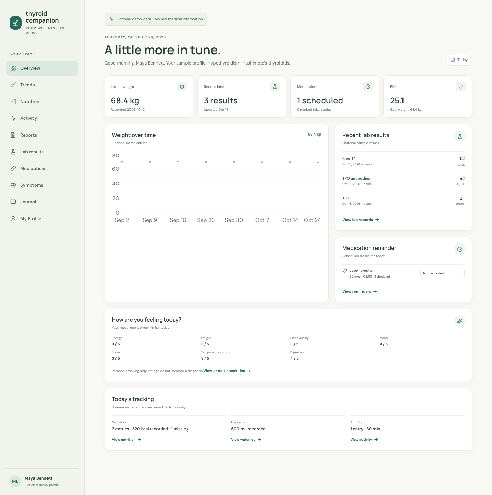

# Thyroid Companion

**[Live Demo — Try Thyroid Companion](https://jaya4ever.github.io/thyroid-companion/)**



A React and TypeScript portfolio app that brings fictional health records into one responsive interface. Track weight, labs, medication schedules, symptoms, nutrition, hydration, and activity; explore trends; and export selected records as a PDF.

Built to demonstrate frontend engineering through typed shared state, reusable validation, interactive charts, and automated tests. No account or installation is needed to try the demo. Changes reset when the page is refreshed.

## Features

| Feature | What you can do |
| --- | --- |
| Dashboard | Review weight, labs, scheduled medication status, symptoms, and daily tracking summaries. |
| Profile and weight | Edit the sample profile, manage weight records, calculate BMI, and explore weight history. |
| Lab results | Add, edit, delete, filter, and chart results with recorded units and optional user-entered reference limits. |
| Medications | Manage schedules, mark doses taken or skipped, and review recorded dose history. |
| Symptoms | Record seven self-reported 1–5 ratings, date and time, and optional notes. |
| Nutrition and hydration | Record meals, optional nutrient values, and water intake in milliliters or fluid ounces. |
| Activity | Record activity type, duration, and optional distance; review weekly and monthly totals. |
| Trends | Explore symptoms, activity, hydration, and nutrition over 7, 30, or 90 days with charts and tables. |
| Reports | Select a date range and sections, preview records, and download a multi-page PDF generated in the browser. |

The Journal navigation item currently opens a placeholder page.

## Technologies

| Area | Tools |
| --- | --- |
| Interface | React, TypeScript, Chakra UI, Emotion |
| Development and build | Vite |
| Navigation | React Router with HashRouter |
| Charts and icons | Recharts, Lucide React |
| PDF export | jsPDF, jsPDF-AutoTable |
| Testing | Vitest, React Testing Library, user-event, jsdom |
| Code checks | TypeScript strict mode, ESLint |
| Hosting | GitHub Pages, GitHub Actions |

Dependency version ranges are listed in `package.json`; exact resolved versions are recorded in `package-lock.json`.

## Run Locally

**Prerequisites:** Node.js 22.x, npm, and Git. No API keys, database, or backend setup are required.

1. Clone the repository and open its folder:

   ```bash
   git clone https://github.com/jaya4ever/thyroid-companion.git
   cd thyroid-companion
   ```

2. Install dependencies:

   ```bash
   npm install
   ```

3. Start the development server:

   ```bash
   npm run dev
   ```

4. Open the local URL printed by Vite, usually **http://localhost:5173**. If that port is occupied, Vite may print a different port.

For an installation that follows the committed lockfile exactly, use `npm ci` instead of `npm install`.

## Development Commands

| Command | Purpose |
| --- | --- |
| `npm run dev` | Start the development server |
| `npm run typecheck` | Check TypeScript without generating files |
| `npm run lint` | Run ESLint |
| `npm run test` | Run the test suite once |
| `npm run test:watch` | Run tests while developing |
| `npm run build` | Generate the production website in `dist/` |
| `npm run preview` | Serve the production build locally |

`npm test` is equivalent to `npm run test`. The build command runs Vite; TypeScript checking is a separate command.

To preview the production build:

```bash
npm run build
npm run preview
```

Open the URL printed by the preview server. Production assets use the `/thyroid-companion/` path configured for GitHub Pages.

## Architecture

```text
src/main.tsx
  └─ StrictMode
       └─ ChakraProvider
            └─ HashRouter
                 └─ HealthDataProvider
                      └─ AppRoutes
                           └─ AppShell + current screen
```

```text
src/
  components/    Shared layout and navigation
  features/      Feature screens and interaction tests
  context/       Shared health records and update actions
  types/         TypeScript definitions for health records
  health/        Calculations, validation, trends, and report helpers
  data/          Fictional starter records
  pages/         General section and placeholder page
  styles.css     App styling and responsive layouts
```

- `src/context/HealthDataContext.tsx` owns shared in-memory records. Screens access them through `useHealthData()` so updates can also appear on the dashboard.
- `src/types/health.ts` defines record shapes and constrained rating and status values. Runtime validation checks user-entered values.
- `src/health/` separates calculations, sorting, validation, and report assembly from screen components.
- Feature screens load through React lazy loading. PDF libraries load when an export is requested.
- Lab comparisons use only entered reference limits and matching units. Medication completion requires explicit user input. Missing nutrient values stay distinct from zero.

## Testing and Accessibility

The current suite has **97 passing tests across 16 test files**, covering calculations, validation, tracking workflows, dashboard updates, trends, report assembly, and PDF generation.

Activity-summary tests use a fixed clock to verify both Monday and Thursday totals without depending on the date the suite runs.

Run the project checks with:

```bash
npm run test
npm run typecheck
npm run lint
npm run build
```

Accessibility features include labeled controls, linked validation messages where applicable, visible focus styles, status announcements, and keyboard-focusable table regions. Trend views provide charts and data tables. Formal accessibility conformance has not been assessed; manual keyboard, screen-reader, and browser testing remain planned work.

The GitHub Pages workflow is started manually and runs lint, TypeScript checks, tests, and the production build before deployment.

## Demo Data and Limitations

- All starter profiles and health records are fictional. Use fictional information only.
- Records live in React memory and reset on refresh. There is no backend, database, authentication, or browser-storage persistence.
- PDFs are generated from selected records in the browser without uploading them to a report service. Reports are labeled **Fictional Demo Data — Not for Medical Use**.
- Google Fonts supplies the app's fonts; health records are not included in font requests. No analytics or health-data API is configured.
- This prototype provides tracking interfaces, not diagnosis or treatment recommendations. It is not intended for clinical use or real patient data and has not undergone a security or compliance assessment.

See [SECURITY.md](SECURITY.md) for further privacy and security notes.

## Screenshot Status

The dashboard image at the top was captured from the local application on October 29, 2026. It shows the current local source; the deployed demo may differ until a deployment is approved.

The older images remain in `docs/screenshots/` as historical assets and are not presented as the latest interface:

| Older file | Why it should be replaced |
| --- | --- |
| `overview-dashboard.png` | Missing Nutrition, Activity, and Reports navigation and the daily tracking summary; superseded here by `overview-dashboard-current.png`. |
| `profile.png` | Shows the older sidebar without Nutrition, Activity, or Reports. |
| `weight-tracking.png` | Shows the older sidebar; duplicates the full profile screenshot rather than focusing on weight tracking. |
| `lab-results.png` | Shows the older sidebar and omits the current saved-result edit/delete actions. |
| `medication-tracking.png` | Shows the older sidebar and omits the current medication edit action. |
| `symptom-check-ins.png` | Shows the older sidebar; should be recaptured with the current navigation. |

Screenshots of nutrition, activity, reports, and trends would provide further examples of the completed features.

## Planned Improvements

- Refresh the remaining feature screenshots.
- Complete manual keyboard, screen-reader, and responsive testing.
- Add end-to-end browser coverage and automated pull-request checks.
- Define consent, retention, export/deletion, and security requirements before adding persistence.
- Confirm unused asset provenance and select a project license before distribution.

## Licensing and Attribution

No project-level license has been selected. Dependency and font notices are documented in [THIRD_PARTY_NOTICES.md](THIRD_PARTY_NOTICES.md). Unused local assets with unverified provenance are excluded from Git and require review before inclusion or distribution.

## Development Process

AI-assisted tools were used during implementation and documentation. Automated tests, TypeScript, ESLint, and production builds support review; these checks do not replace human review.
